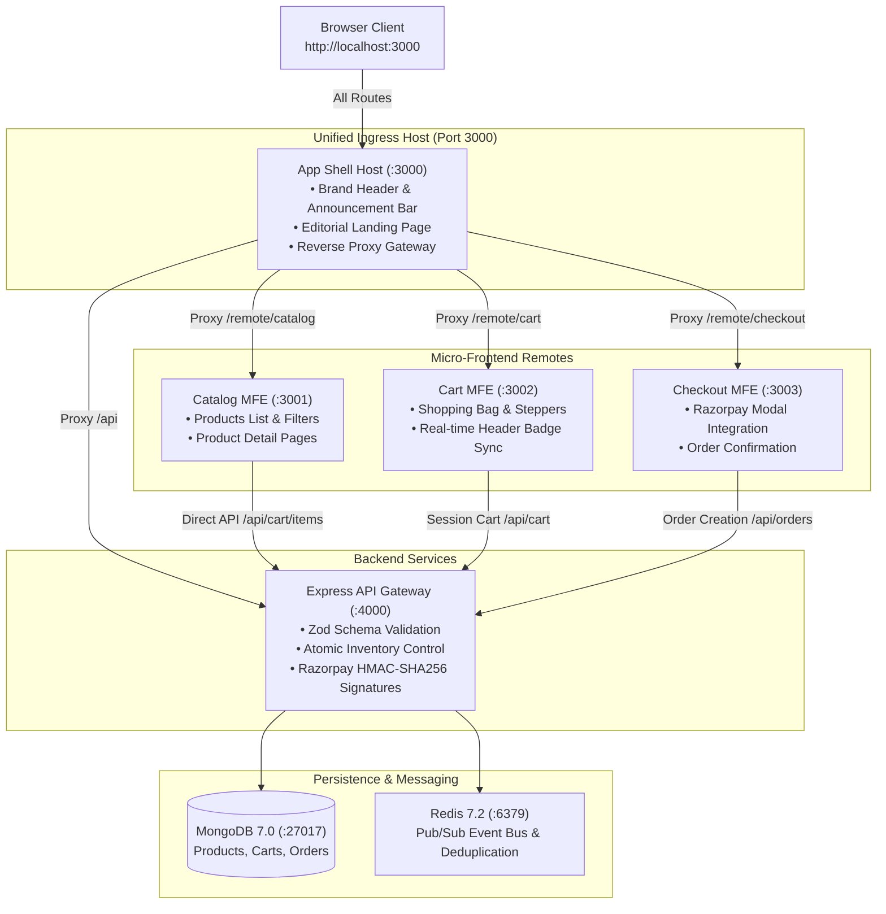

# VÊTU — Headless Micro-Frontend E-Commerce Platform

A production-aligned headless luxury e-commerce platform built with independently deployable React micro-frontends (Webpack 5 Module Federation), a unified single-port browser ingress at `http://localhost:3000`, a Node.js/Express API gateway, MongoDB 7 persistence, Redis 7.2 Pub/Sub event-driven inventory processing with envelope deduplication, and Razorpay Standard Checkout in Test Mode.

---

## Architecture Overview



---

## Authoritative Documentation & Project Memory

The VÊTU repository maintains strict, evidence-based continuity documentation:

* [**`MEMORY.md`**](file:///c:/College%20Work/Internship/Infyntrek/Project%202/MEMORY.md): **The central development continuity document and living project memory.** All future AI coding agents and human engineers must read this document before proposing changes. It records the verified technical stack, component boundaries, chronological development audit, verified testing metrics, inviolable architectural rules, and technical debt.
* [**`docs/SYSTEM.md`**](file:///c:/College%20Work/Internship/Infyntrek/Project%202/docs/SYSTEM.md): System architecture, single-port ingress topology, Module Federation remote routing, and cart synchronization protocol.
* [**`docs/API.md`**](file:///c:/College%20Work/Internship/Infyntrek/Project%202/docs/API.md): Complete backend REST API reference, request/response contracts, and query parameters.
* [**`docs/SECURITY.md`**](file:///c:/College%20Work/Internship/Infyntrek/Project%202/docs/SECURITY.md): Security architecture, JWT verification, rate limiting, and HMAC-SHA256 signature verification.
* [**`docs/DEPLOYMENT.md`**](file:///c:/College%20Work/Internship/Infyntrek/Project%202/docs/DEPLOYMENT.md): Container operations, environment variables, and Docker Compose lifecycle.
* [**`docs/MICROFRONTEND_INTEGRATION_AUDIT.md`**](file:///c:/College%20Work/Internship/Infyntrek/Project%202/docs/MICROFRONTEND_INTEGRATION_AUDIT.md): Comprehensive microfrontend integration audit and 22-step browser test verification evidence.

---

## Monorepo Structure

```
Project 2/
├── MEMORY.md                       # Living project memory & development continuity ledger
├── package.json                    # Monorepo workspaces manifest
├── tsconfig.base.json              # Shared TypeScript base configuration
├── docker-compose.yml              # Complete container orchestration
├── scripts/
│   └── verify-full-flow.mjs        # 22-step headless Chrome CDP end-to-end test suite
├── docs/                           # Authoritative project documentation & audit
│   ├── MICROFRONTEND_INTEGRATION_AUDIT.md # Architecture stabilization & root cause audit
│   ├── PRD.md                      # Product requirements & acceptance criteria
│   ├── SYSTEM.md                   # System architecture & topology
│   ├── DESIGN.md                   # Technical design & event bus specifications
│   ├── DATA_MODEL.md               # MongoDB schemas, indexes & payment models
│   ├── API.md                      # API reference & contracts
│   ├── SECURITY.md                 # Security review & remediations
│   ├── TEST.md                     # Test strategy & verification results
│   ├── STOREFRONT_UI_MODERNIZATION.md # MFE design token modernization report
│   ├── FINAL_LANDING_PAGE_REVIEW.md# Landing page motion & performance review
│   └── ADR.md                      # Architecture decision records
├── packages/
│   ├── shared/                     # Shared TypeScript types, interfaces & constants
│   ├── shell/                      # App Shell (Module Federation Host & Proxy :3000)
│   ├── catalog/                    # Catalog MFE (Remote :3001)
│   ├── cart/                       # Cart MFE (Remote :3002)
│   └── checkout/                   # Checkout MFE (Remote :3003)
└── services/
    └── api-gateway/                # Express API Gateway, MongoDB, Redis, Razorpay (:4000)
```

---

## Key Features & Requirements Coverage

| Requirement | Description | Implementation Details |
|---|---|---|
| **FR-01** | Product catalog, variants & availability | MongoDB `ProductModel` with multi-variant SKUs, pricing, and active-state filtering. Soft-deleted products are hidden from public requests. |
| **FR-02** | Product search, filtering, and browsing | Server-side text search, category filtering, multi-attribute sorting, and pagination. |
| **FR-03** | Independent Micro-Frontends | 4 isolated apps (`shell`, `catalog`, `cart`, `checkout`) with dedicated Dockerfiles, Nginx configs & Webpack configs. |
| **FR-04** | Webpack Module Federation | Shell dynamically loads remote bundles at runtime with shared singleton React 18 & React Router 6. |
| **FR-05** | Express API Gateway | Helmet security headers, CORS origin control, rate limiting, structured Winston logging with credential masking. |
| **FR-06** | Cart management & state synchronization | Backend-authoritative cart with session persistence (`vetu_cart_session`), real-time `cart:updated` / `cart:refresh` events, and persistent Shell Header badge. |
| **FR-07** | Redis event-driven inventory | Redis Pub/Sub channels (`inventory:updated`, `inventory:reserved`, `inventory:released`) with `EventEnvelope` deduplication to prevent double execution. |
| **FR-08** | Razorpay Standard Checkout | Integrated official Razorpay SDK in Test Mode with server-side order calculation in paise and modal checkout. |
| **FR-09** | Payment Verification & Consistency | Timing-safe HMAC-SHA256 signature verification (`POST /api/orders/payments/verify`), atomic inventory deduction, and idempotent confirmation. |
| **FR-10** | Product Write Authorization | Admin routes (`POST`, `PATCH`, `DELETE` on `/api/products`) protected with `requireAdmin` JWT middleware. |
| **FR-11** | Clickstream analytics & dashboard | Event ingestion (`page_view`, `product_view`, `add_to_cart`, `checkout_step`) and real-time KPI dashboard. |
| **FR-12** | Structured logging & error handling | Centralized `errorHandler`, RFC-compliant error objects, Winston file & console logging with masked secrets. |
| **FR-13** | Docker & Docker Compose | Multi-stage Dockerfiles for all micro-frontends and backend; complete `docker-compose.yml`. |
| **FR-14** | Automated Testing | **89 automated regression tests** passing across 8 suites in Vitest, plus **22 browser CDP integration tests** (100% passing). |

---

## Quickstart & Development

### 1. Prerequisites
- **Node.js**: >= 18.0.0 (tested on Node.js v22.23.2)
- **npm**: >= 9.0.0
- **MongoDB**: >= 7.0 (local community edition or container)
- **Redis**: >= 7.2 (local or cloud instance)
- **Google Chrome**: For headless CDP automated integration testing

### 2. Install Dependencies
```bash
npm install
```

### 3. Build Workspaces
```bash
npm run build:shared
npm run build:api
npm run build:catalog
npm run build:cart
npm run build:checkout
npm run build:shell
```

### 4. Run Automated Backend Tests
```bash
npm run test:api
```
*Executes all 89 integration tests across Product, Cart, Order, Razorpay, Concurrency, Redis, and Analytics using Vitest.*

### 5. Local Workspace Development (Unified Single-Port Ingress)
All user journeys route through **`http://localhost:3000`**:
```bash
# Terminal 1: API Gateway (:4000)
npm run dev:api

# Terminal 2: Catalog Remote (:3001)
npm run dev:catalog

# Terminal 3: Cart Remote (:3002)
npm run dev:cart

# Terminal 4: Checkout Remote (:3003)
npm run dev:checkout

# Terminal 5: Shell Host & Gateway (:3000)
npm run dev:shell
```

### 6. Run Automated Browser Integration Suite
```bash
node scripts/verify-full-flow.mjs
```
*Executes 22 automated end-to-end tests via Chrome DevTools Protocol validating Home, Catalog, PDP (by slug & ID), Add to Bag, Cart badge update, Cart persistence, Checkout summary, back/forward navigation, and header alignment.*

### 7. Seed Sample Products
```bash
npm run seed
```
> [!WARNING]
> The seed script runs `ProductModel.deleteMany({})` before inserting sample items. Only run against disposable development databases.

---

## API Summary

### Products (`/api/products`)
- `GET /api/products` — Paginated catalog with search, category, and price filters (active products only)
- `GET /api/products/:id` — Single product by ID (404 for inactive products; admin can view via `?includeInactive=true`)
- `GET /api/products/slug/:slug` — Single product by URL slug
- `GET /api/products/categories` — List distinct categories
- `POST /api/products` — **Admin only**: Create new product (requires `Authorization: Bearer <admin_token>`)
- `PATCH /api/products/:id` — **Admin only**: Update product details
- `DELETE /api/products/:id` — **Admin only**: Soft-delete product

### Cart (`/api/cart`)
- `GET /api/cart` — Fetch session cart (requires `x-cart-session` header)
- `POST /api/cart/items` — Add item with inventory validation
- `PATCH /api/cart/items/:sku` — Update item quantity
- `DELETE /api/cart/items/:sku` — Remove item from cart
- `DELETE /api/cart` — Clear cart

### Orders & Payments (`/api/orders`)
- `POST /api/orders` — Create order from current cart and initialize Razorpay order in paise
- `GET /api/orders/:id` — Retrieve order by internal ID
- `GET /api/orders/number/:orderNumber` — Retrieve order by order number
- `POST /api/orders/payments/verify` — Verify Razorpay payment signature (HMAC-SHA256), deduct inventory, confirm order (idempotent)
- `POST /api/orders/payments/confirm` — *Disabled* (returns 400 Bad Request)

### Analytics (`/api/analytics`)
- `POST /api/analytics/events` — Ingest clickstream event
- `POST /api/analytics/events/batch` — Batch ingestion of interaction events
- `GET /api/analytics/dashboard` — Aggregated KPI metrics & conversion funnel
- `GET /api/analytics/predictive/:slug` — Frequently co-viewed products

---

## License
MIT
