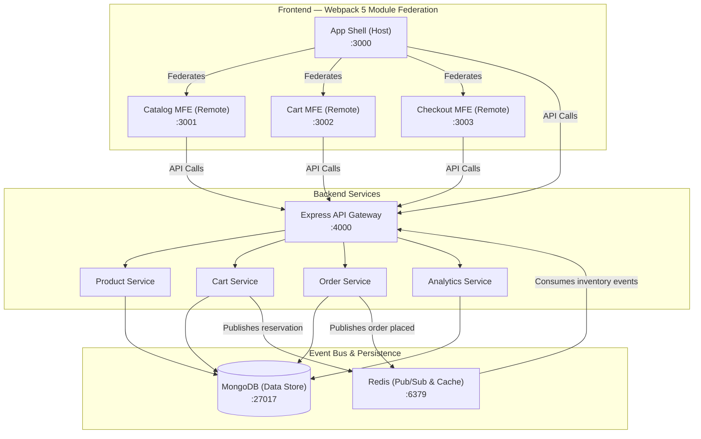

# VÊTU — Headless Micro-Frontend E-Commerce with Edge Analytics

A scalable, production-grade headless e-commerce platform built with independently deployable React micro-frontends (Webpack Module Federation), a Node.js/Express API gateway, MongoDB persistence, Redis Pub/Sub event-driven inventory processing, and edge predictive prefetching.

---

## Architecture Overview



---

## Monorepo Structure

```
Project 2/
├── package.json                    # Monorepo workspaces manifest
├── tsconfig.base.json              # Shared TypeScript base configuration
├── docker-compose.yml              # Complete container orchestration
├── .github/
│   └── workflows/
│       └── ci.yml                  # GitHub Actions CI (lint, test, build, Docker)
├── packages/
│   ├── shared/                     # Shared TypeScript types, interfaces & constants
│   ├── shell/                      # App Shell (Module Federation Host :3000)
│   ├── catalog/                    # Catalog MFE (Remote :3001)
│   ├── cart/                       # Cart MFE (Remote :3002)
│   └── checkout/                   # Checkout MFE (Remote :3003)
└── services/
    └── api-gateway/                # Express API Gateway, MongoDB, Redis, Stripe (:4000)
```

---

## Key Features & Requirements Coverage

| Requirement | Description | Implementation Details |
|---|---|---|
| **FR-01** | Product catalog, variants, SKUs & availability | MongoDB `ProductModel` with multi-variant SKUs, real-time stock counters, pricing, and tags. |
| **FR-02** | Product search, filtering, and browsing | Server-side text search, category filtering, multi-attribute sorting, and pagination. |
| **FR-03** | Independent Micro-Frontends | 4 isolated apps (`shell`, `catalog`, `cart`, `checkout`) with dedicated Dockerfiles & Nginx configs. |
| **FR-04** | Webpack Module Federation | Shell dynamically loads remote bundles at runtime with shared singleton React 18 & React Router 6. |
| **FR-05** | Express API Gateway | Helmet security, CORS origin control, rate limiting, structured Winston logging, and Morgan stream. |
| **FR-06** | Cart management & state synchronization | Session-based cart with server-side validation and cross-MFE CustomEvent bus (`cart:updated`, `cart:add`). |
| **FR-07** | Redis event-driven inventory | Redis Pub/Sub channel `inventory:updated`, `inventory:reserved`, and `inventory:released` with consumer workers. |
| **FR-08** | Payment processing & webhooks | Stripe integration pattern with test card support, HMAC-SHA256 webhook verification, and idempotency. |
| **FR-09** | Order & inventory consistency | Atomic order placement, automatic inventory decrement upon payment confirmation, and cart clearing. |
| **FR-10** | Clickstream analytics & dashboard | Event ingestion (`page_view`, `product_view`, `add_to_cart`, `checkout_step`) and real-time KPI dashboard. |
| **FR-11** | Predictive UI prefetching | Intent-driven hover detection, Markov transition probability prefetch, and latency savings tracking. |
| **FR-12** | Structured logging & error handling | Centralized `errorHandler`, RFC-compliant error objects, Winston file & console logging. |
| **FR-13** | Docker & Docker Compose | Multi-stage Dockerfiles for all micro-frontends and backend; complete `docker-compose.yml`. |
| **FR-14** | CI/CD Pipeline | Automated GitHub Actions CI workflow running typechecks, 45 test cases, and Docker build validations. |

---

## Quickstart & Development

### 1. Prerequisites
- **Node.js**: >= 18.0.0
- **npm**: >= 9.0.0
- **Docker & Docker Compose** (optional for containerized run)

### 2. Install Dependencies
```bash
npm install
```

### 3. Build Shared Packages
```bash
npm run build:shared
```

### 4. Run Automated Tests
```bash
npm run test:api
```
*Executes all 45 integration tests across Product, Cart, Order, Webhooks, Inventory Events, and Analytics.*

### 5. Start with Docker Compose
```bash
npm run docker:up
```
This boots up:
- **MongoDB** on `localhost:27017`
- **Redis** on `localhost:6379`
- **API Gateway** on `http://localhost:4000`
- **Catalog MFE** on `http://localhost:3001`
- **Cart MFE** on `http://localhost:3002`
- **Checkout MFE** on `http://localhost:3003`
- **App Shell (Host)** on `http://localhost:3000`

### 6. Local Workspace Development
To run micro-frontends and backend independently:
```bash
# Terminal 1: API Gateway
npm run dev:api

# Terminal 2: Shell Host
npm run dev:shell

# Terminal 3: Catalog Remote
npm run dev:catalog

# Terminal 4: Cart Remote
npm run dev:cart

# Terminal 5: Checkout Remote
npm run dev:checkout
```

### 7. Seed Sample Products
```bash
npm run seed
```

---

## API Reference

### Products
- `GET /api/products` — Paginated catalog with search, category, and price filters
- `GET /api/products/:id` — Single product by ID
- `GET /api/products/slug/:slug` — Single product by URL slug
- `GET /api/products/categories` — List distinct categories
- `POST /api/products` — Create new product (with variants & SKUs)
- `PATCH /api/products/:id` — Update product details
- `DELETE /api/products/:id` — Soft-delete product

### Cart
- `GET /api/cart` — Fetch session cart (requires `x-cart-session` header)
- `POST /api/cart/items` — Add item with inventory validation
- `PATCH /api/cart/items/:sku` — Update item quantity
- `DELETE /api/cart/items/:sku` — Remove item from cart
- `DELETE /api/cart` — Clear cart

### Orders & Payments
- `POST /api/orders` — Create order from current cart (supports `idempotency-key`)
- `GET /api/orders/:orderNumber` — Retrieve order confirmation
- `POST /api/orders/payments/confirm` — Authorize/confirm payment
- `POST /api/orders/payments/webhook` — Stripe webhook receiver with signature validation

### Analytics & Predictive Prefetching
- `POST /api/analytics/events` — Ingest clickstream event
- `POST /api/analytics/events/batch` — Batch ingestion of interaction events
- `GET /api/analytics/dashboard` — Aggregated KPI metrics & conversion funnel
- `GET /api/analytics/predictive/:slug` — Markov co-viewed products for edge prefetch

---

## Micro-Frontend Communication

1. **Module Federation**:
   - The Shell host configures remotes for `catalog`, `cart`, and `checkout`.
   - Shared dependencies (`react`, `react-dom`, `react-router-dom`) are declared as singletons to prevent multiple runtime instances.

2. **Cross-MFE Event Bus**:
   - `cart:add`: Dispatched by the Catalog MFE when a user clicks "Add to Cart". Subscribed by the Cart MFE.
   - `cart:updated`: Dispatched whenever items are modified. Subscribed by the Shell Header to keep the badge count synchronized in real time.
   - `cart:refresh`: Forces cart recalculation across remotes.

3. **Predictive Edge Prefetching**:
   - The `predictivePrefetch` engine listens to hover intent.
   - As a user browses, it queries `/api/analytics/predictive/:slug` to pre-cache next likely items into memory, reducing navigation latency to ~0ms.

---

## License
MIT
