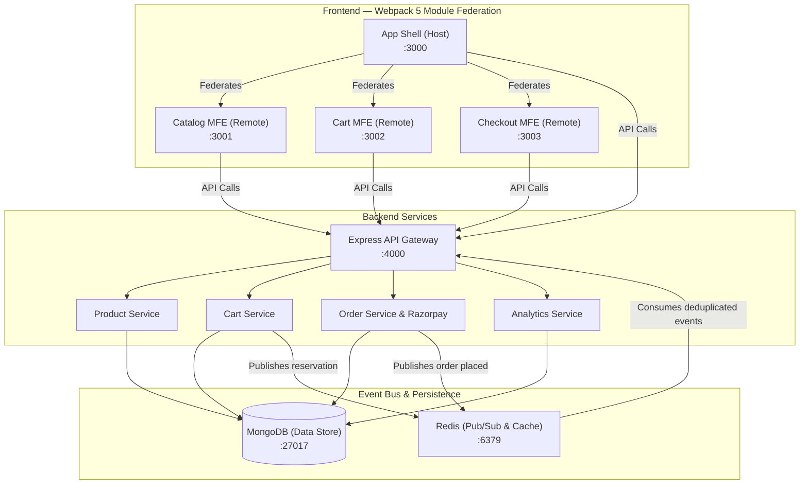

# VÊTU — Headless Micro-Frontend E-Commerce Platform

A production-aligned headless e-commerce platform built with independently deployable React micro-frontends (Webpack 5 Module Federation), a Node.js/Express API gateway, MongoDB 7 persistence, Redis 7.2 Pub/Sub event-driven inventory processing with envelope deduplication, and Razorpay Standard Checkout in Test Mode.

---

## Architecture Overview



---

## Monorepo Structure

```
Project 2/
├── package.json                    # Monorepo workspaces manifest
├── tsconfig.base.json              # Shared TypeScript base configuration
├── docker-compose.yml              # Complete container orchestration
├── docs/                           # Authoritative project documentation & audit
│   ├── PRD.md                      # Product requirements & acceptance criteria
│   ├── SYSTEM.md                   # System architecture & topology
│   ├── DESIGN.md                   # Technical design & event bus specifications
│   ├── DATA_MODEL.md               # MongoDB schemas, indexes & payment models
│   ├── API.md                      # API reference & contracts
│   ├── SECURITY.md                 # Security review & remediations
│   ├── TEST.md                     # Test strategy & verification results
│   ├── ADR.md                      # Architecture decision records
│   ├── DEPLOYMENT.md               # Operations & environment guide
│   ├── RESULT.md                   # Audit verification & gap resolution matrix
│   └── INDEX.md                    # Documentation index
├── packages/
│   ├── shared/                     # Shared TypeScript types, interfaces & constants
│   ├── shell/                      # App Shell (Module Federation Host :3000)
│   ├── catalog/                    # Catalog MFE (Remote :3001)
│   ├── cart/                       # Cart MFE (Remote :3002)
│   └── checkout/                   # Checkout MFE (Remote :3003)
└── services/
    └── api-gateway/                # Express API Gateway, MongoDB, Redis, Razorpay (:4000)
```

---

## Key Features & Requirements Coverage

| Requirement | Description | Implementation Details |
|---|---|---|
| **FR-01** | Product catalog, variants & availability | MongoDB `ProductModel` with multi-variant SKUs, pricing, and active-state filtering. Soft-deleted products are hidden from public requests. |
| **FR-02** | Product search, filtering, and browsing | Server-side text search, category filtering, multi-attribute sorting, and pagination. |
| **FR-03** | Independent Micro-Frontends | 4 isolated apps (`shell`, `catalog`, `cart`, `checkout`) with dedicated Dockerfiles & Nginx configs. |
| **FR-04** | Webpack Module Federation | Shell dynamically loads remote bundles at runtime with shared singleton React 18 & React Router 6. |
| **FR-05** | Express API Gateway | Helmet security headers, CORS origin control, rate limiting, structured Winston logging with credential masking. |
| **FR-06** | Cart management & state synchronization | Session-based cart with server-side validation (`x-cart-session`) and cross-MFE CustomEvent bus (`cart:updated`, `cart:add`). |
| **FR-07** | Redis event-driven inventory | Redis Pub/Sub channels (`inventory:updated`, `inventory:reserved`, `inventory:released`) with `EventEnvelope` deduplication to prevent double execution. |
| **FR-08** | Razorpay Standard Checkout | Integrated official Razorpay SDK in Test Mode with server-side order calculation in paise and modal checkout. |
| **FR-09** | Payment Verification & Consistency | Timing-safe HMAC-SHA256 signature verification (`POST /api/orders/payments/verify`), atomic inventory deduction, and idempotent confirmation. |
| **FR-10** | Product Write Authorization | Admin routes (`POST`, `PATCH`, `DELETE` on `/api/products`) protected with `requireAdmin` JWT middleware. |
| **FR-11** | Clickstream analytics & dashboard | Event ingestion (`page_view`, `product_view`, `add_to_cart`, `checkout_step`) and real-time KPI dashboard. |
| **FR-12** | Structured logging & error handling | Centralized `errorHandler`, RFC-compliant error objects, Winston file & console logging with masked secrets. |
| **FR-13** | Docker & Docker Compose | Multi-stage Dockerfiles for all micro-frontends and backend; complete `docker-compose.yml`. |
| **FR-14** | Automated Testing | **67 automated regression tests** passing across 5 test suites executed via **Vitest**. |

---

## Quickstart & Development

### 1. Prerequisites
- **Node.js**: >= 18.0.0 (tested on Node.js v22.23.2)
- **npm**: >= 9.0.0
- **MongoDB**: >= 7.0
- **Redis**: >= 7.2 (supports standalone password & URL authentication)
- **Docker & Docker Compose** (for containerized stack)

### 2. Install Dependencies
```bash
npm install
```

### 3. Build Workspaces
```bash
npm run build:shared
npm run build:api
npm run build:checkout
```

### 4. Run Automated API Tests
```bash
npm run test:api
```
*Executes all 67 integration tests across Product, Cart, Order, Razorpay, Redis Auth, and Analytics using Vitest.*

### 5. Local Workspace Development
To run micro-frontends and backend independently:
```bash
# Terminal 1: API Gateway (:4000)
npm run dev:api

# Terminal 2: Shell Host (:3000)
npm run dev:shell

# Terminal 3: Catalog Remote (:3001)
npm run dev:catalog

# Terminal 4: Cart Remote (:3002)
npm run dev:cart

# Terminal 5: Checkout Remote (:3003)
npm run dev:checkout
```

### 6. Start with Docker Compose
```bash
docker compose up --build
```
Boots up:
- **MongoDB** on `localhost:27017`
- **Redis** on `localhost:6379`
- **API Gateway** on `http://localhost:4000`
- **Catalog MFE** on `http://localhost:3001`
- **Cart MFE** on `http://localhost:3002`
- **Checkout MFE** on `http://localhost:3003`
- **App Shell (Host)** on `http://localhost:3000`

### 7. Seed Sample Products
```bash
npm run seed
```
> [!WARNING]
> The seed script runs `ProductModel.deleteMany({})` before inserting sample items. Only run against disposable development databases.

---

## API Summary

### Products (`/api/products`)
- `GET /api/products` — Paginated catalog with search, category, and price filters (active products only)
- `GET /api/products/:id` — Single product by ID (404 for inactive products; admin can view via `?includeInactive=true`)
- `GET /api/products/slug/:slug` — Single product by URL slug
- `GET /api/products/categories` — List distinct categories
- `POST /api/products` — **Admin only**: Create new product (requires `Authorization: Bearer <admin_token>`)
- `PATCH /api/products/:id` — **Admin only**: Update product details
- `DELETE /api/products/:id` — **Admin only**: Soft-delete product

### Cart (`/api/cart`)
- `GET /api/cart` — Fetch session cart (requires `x-cart-session` header)
- `POST /api/cart/items` — Add item with inventory validation
- `PATCH /api/cart/items/:sku` — Update item quantity
- `DELETE /api/cart/items/:sku` — Remove item from cart
- `DELETE /api/cart` — Clear cart

### Orders & Payments (`/api/orders`)
- `POST /api/orders` — Create order from current cart and initialize Razorpay order in paise
- `GET /api/orders/:id` — Retrieve order by internal ID
- `GET /api/orders/number/:orderNumber` — Retrieve order by order number
- `POST /api/orders/payments/verify` — Verify Razorpay payment signature (HMAC-SHA256), deduct inventory, confirm order (idempotent)
- `POST /api/orders/payments/confirm` — *Disabled* (returns 400 Bad Request)

### Analytics (`/api/analytics`)
- `POST /api/analytics/events` — Ingest clickstream event
- `POST /api/analytics/events/batch` — Batch ingestion of interaction events
- `GET /api/analytics/dashboard` — Aggregated KPI metrics & conversion funnel
- `GET /api/analytics/predictive/:slug` — Frequently co-viewed products

---

## License
MIT
